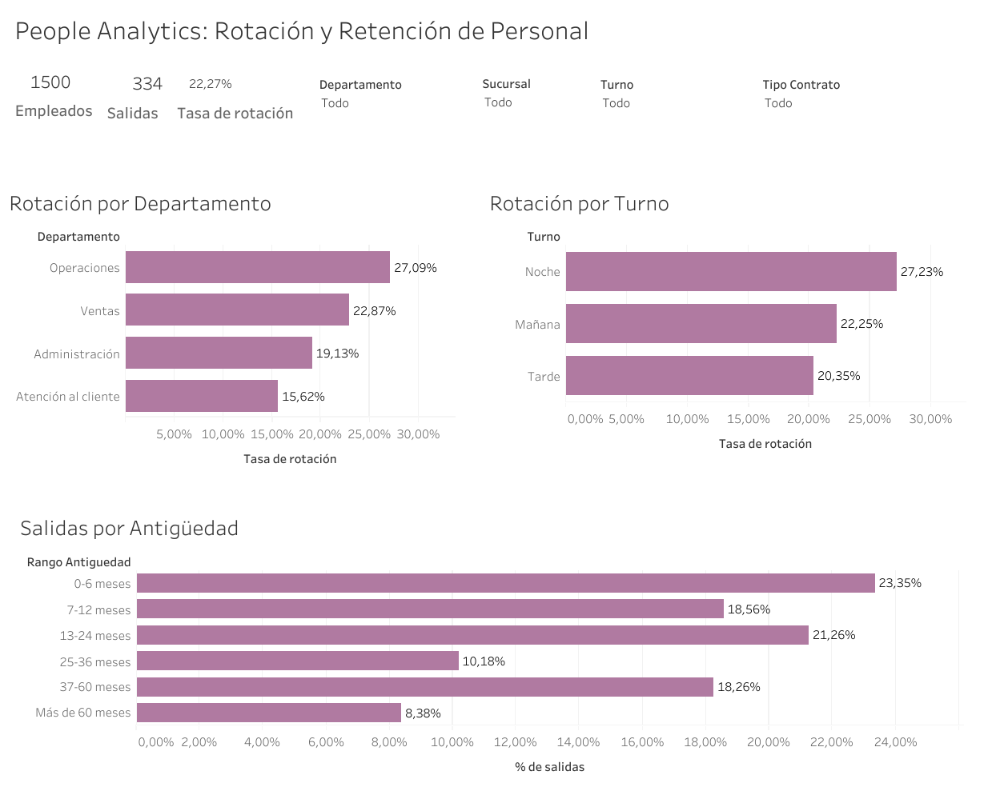

# People Analytics: Rotación y Retención de Personal

Proyecto de portafolio orientado a **People Analytics**, enfocado en analizar patrones asociados a la rotación de personal e identificar segmentos que requieren mayor atención.

## Objetivo

Analizar una base sintética de 1.500 empleados para responder preguntas como:

- ¿Qué departamentos presentan mayor tasa de rotación?
- ¿Qué turnos muestran mayor rotación?
- ¿Qué tipo de contrato se asocia con mayor rotación?
- ¿Cómo se distribuyen las salidas según antigüedad?
- ¿Qué variables presentan asociaciones relevantes con la salida de empleados?

> **Nota:** el dataset es sintético y fue creado con fines educativos y de portafolio. Los resultados muestran asociaciones descriptivas y no deben interpretarse como causalidad.

## Herramientas

- Python
- Pandas
- SQL / SQLite
- Tableau Public
- Google Colab

## Resultados principales

- **Empleados analizados:** 1.500
- **Salidas:** 334
- **Tasa general de rotación:** 22,27%
- **Departamento con mayor rotación:** Operaciones — 27,09%
- **Turno con mayor rotación:** Noche — 27,23%
- **Contrato con mayor rotación:** Plazo fijo — 27,68%
- **63,17% de las salidas observadas ocurrieron durante los primeros 24 meses de antigüedad.**

También se observó que los niveles más bajos de satisfacción presentan una mayor rotación en este escenario sintético. Este resultado se interpreta como una **asociación**, no como evidencia de causalidad.

## Análisis realizado

- Revisión de calidad de datos
- Cálculo de tasa general de rotación
- Rotación por departamento
- Rotación por turno
- Análisis conjunto de departamento y turno
- Rotación por tipo de contrato
- Análisis de horas extra
- Análisis de satisfacción
- Distribución de salidas por antigüedad
- Validación de resultados mediante SQL
- Dashboard interactivo en Tableau

## Consideración metodológica

Para la antigüedad no se calculó una “tasa de rotación por rango” usando una población mezclada de empleados activos y personas que salieron.

En su lugar, se analizó la **distribución de las salidas según el momento de antigüedad en que ocurrieron**, evitando utilizar un denominador incorrecto.

## Dashboard en Tableau

El dashboard incluye KPI de empleados, salidas y tasa de rotación, además de visualizaciones por departamento, turno y antigüedad, con filtros por sucursal, departamento, turno y tipo de contrato.

**Tableau Public:** https://public.tableau.com/app/profile/diana.stefania.perez.acu.a/viz/PeopleAnalytics-RotacinyRetencindePersonal/PeopleAnalyticsRotacinyRetencindePersonal

### Vista previa del dashboard

## Archivos del repositorio

- `Caso_Estudio_2_Rotacion_Personal.ipynb` — análisis en Python y SQL
- `datos_rotacion_personal.csv` — dataset utilizado
- `dashboard_people_analytics.png` — vista previa del dashboard
- `README.md` — documentación del proyecto

## Autora

**Diana Pérez Acuña**  
Portafolio de Data Analytics
